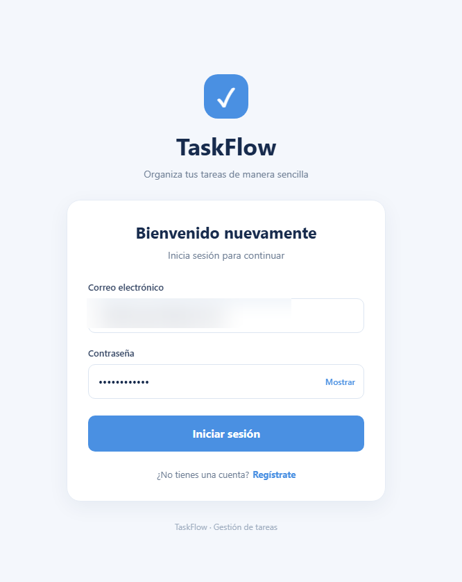
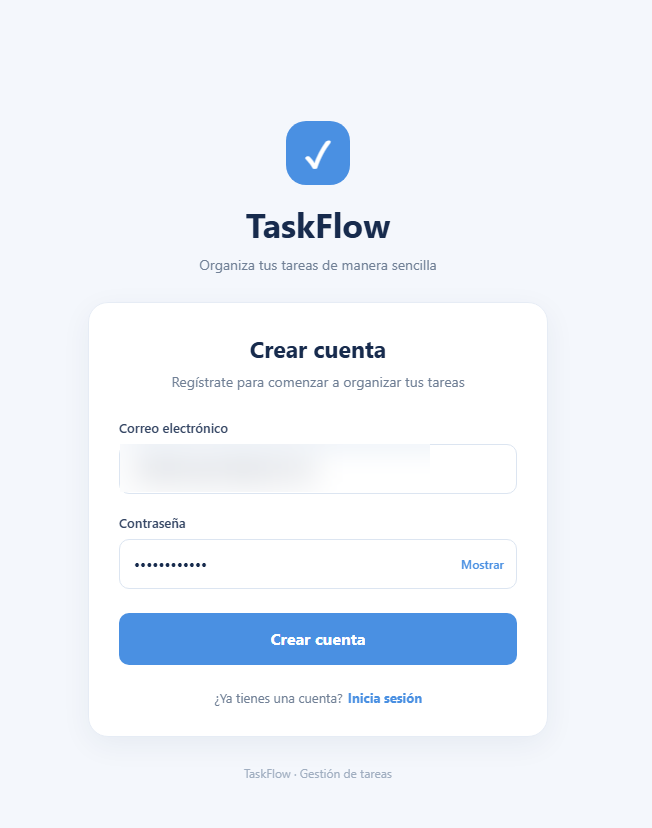
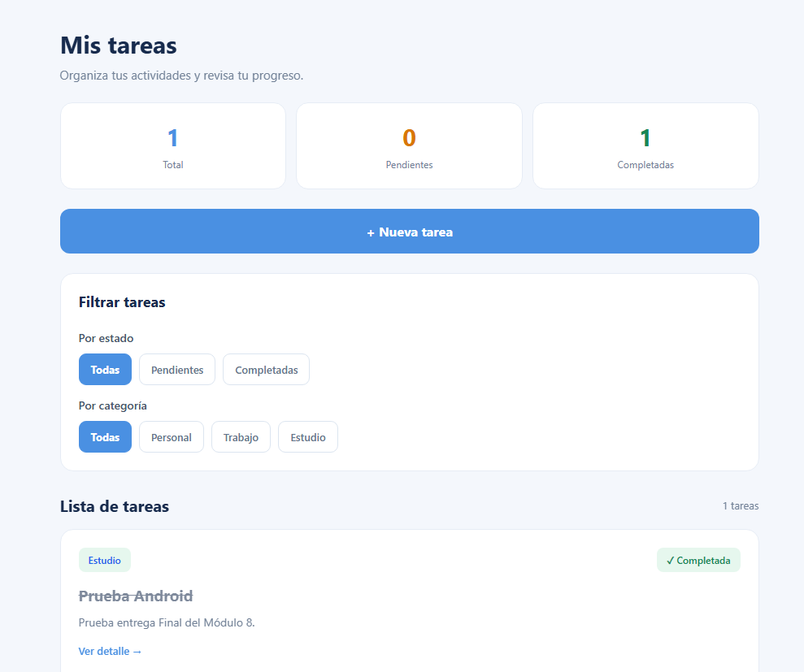
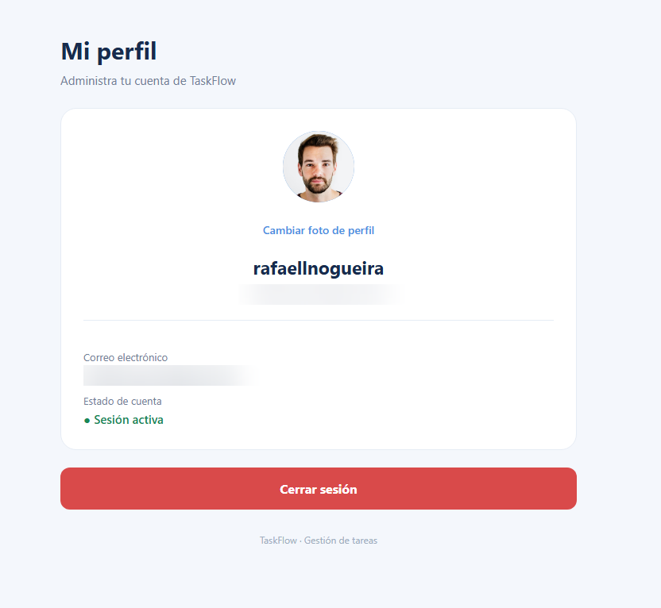

# TaskFlow — Entrega Final | Módulo 8

**Aplicación de gestión de tareas desarrollada con React Native, Expo, Redux Toolkit y Firebase.**

**Repositorio:** https://github.com/rafaelnogueira91/Proyecto-TaskFlow

## 1. Descripción del proyecto

TaskFlow permite organizar actividades personales, laborales y académicas mediante una aplicación con autenticación de usuarios, tareas almacenadas en la nube y un perfil personalizable. El proyecto reúne las funcionalidades desarrolladas durante los módulos del programa y cuenta con pruebas de funcionamiento en Android y web.

## 2. Tecnologías utilizadas

| Tecnología | Uso en TaskFlow |
|---|---|
| React Native y JavaScript | Desarrollo de la aplicación |
| Expo | Ejecución en Android y web |
| React Navigation | Navegación Stack y Bottom Tabs |
| Redux Toolkit y React Redux | Estado global de tareas |
| Firebase Authentication | Registro, inicio y cierre de sesión |
| Cloud Firestore | Almacenamiento de tareas por usuario |
| `onSnapshot` | Actualización de tareas desde Firestore |
| AsyncStorage | Persistencia local de autenticación y avatar |
| Expo ImagePicker | Selección de fotografía de perfil |
| Git y GitHub | Control de versiones y entrega |

## 3. Funcionalidades

### Autenticación

- Registro e inicio de sesión con correo electrónico y contraseña.
- Validación de credenciales y manejo de errores de autenticación.
- Rutas privadas condicionadas al usuario autenticado.
- Cierre de sesión y recuperación del estado de autenticación con `onAuthStateChanged`.
- Configuración de persistencia nativa mediante `initializeAuth`, `getReactNativePersistence` y AsyncStorage.

### Gestión de tareas

- Crear tareas con título, descripción y categoría.
- Consultar la lista y el detalle de cada tarea.
- Marcar tareas como completadas o pendientes y eliminarlas.
- Filtrar por categoría y estado.
- Consultar contadores de tareas totales, pendientes y completadas.
- Almacenar tareas en Firestore asociadas al campo `userId`.
- Actualizar el estado de Redux mediante un listener `onSnapshot` de Firestore.

### Perfil

- Consultar datos de la cuenta y estado de la sesión.
- Seleccionar una fotografía desde la galería con Expo ImagePicker.
- Mostrar el avatar seleccionado y conservarlo localmente con AsyncStorage.
- Cerrar sesión desde la pantalla de perfil.

**Alcance del avatar:** se guarda en el dispositivo o navegador donde se seleccionó; no se sincroniza entre dispositivos mediante Firebase Storage.

## 4. Organización del proyecto

```text
taskflow-app/
├── App.js
├── app.json
├── package.json
├── README.md
├── firestore.rules.example
├── assets/
├── docs/
│   └── evidencias/
│       ├── 01-login.png
│       ├── 02-registro.png
│       ├── 03-tareas.png
│       └── 04-perfil.png
└── src/
    ├── components/
    ├── constants/
    ├── screens/
    ├── services/
    │   └── firebaseConfig.js
    └── store/
```

`App.js` integra autenticación, navegación y escucha de Firestore. `src/store/` contiene el estado global; `src/screens/` contiene las pantallas y `src/services/firebaseConfig.js` centraliza la inicialización de Firebase.

## 5. Instalación y ejecución

**Requisitos:** Node.js, npm, un proyecto Firebase con Authentication (Email/Password) y Firestore habilitados, y Expo Go compatible con la versión SDK instalada en el proyecto.

Clonar el repositorio:

```bash
git clone https://github.com/rafaelnogueira91/Proyecto-TaskFlow.git
cd Proyecto-TaskFlow
```

Si `package.json` se encuentra en una subcarpeta, ingresar primero a esa carpeta.

Instalar dependencias e iniciar Expo:

```bash
npm install
npx expo start
```

Para abrir en el navegador:

```bash
npx expo start --web
```

Para abrir en Android, iniciar Expo Go y escanear el código QR que muestra la terminal. El teléfono y el computador deben poder comunicarse por red. Como alternativa de conexión:

```bash
npx expo start --tunnel
```

Para limpiar la caché de Expo:

```bash
npx expo start -c
```

La configuración de Firebase se encuentra en `src/services/firebaseConfig.js`. Para usar otro proyecto Firebase, configurar sus valores y habilitar los servicios necesarios. **No incluir contraseñas, cuentas de servicio, claves privadas ni archivos `.env` con secretos en el repositorio.**

## 6. Seguridad de Firestore

El proyecto incluye reglas de referencia en `firestore.rules.example` para restringir el acceso a documentos de la colección `tasks` según el usuario autenticado.

| Operación | Condición |
|---|---|
| Crear | `request.resource.data.userId == request.auth.uid` |
| Leer y eliminar | `resource.data.userId == request.auth.uid` |
| Actualizar | El usuario es propietario y el `userId` no cambia |

Las reglas deben publicarse y verificarse en **Firebase Console → Firestore Database → Reglas**. El archivo del repositorio, por sí solo, no activa las reglas en el servidor.

## 7. Pruebas de funcionamiento

Durante el desarrollo se observó el funcionamiento de TaskFlow en navegador web y Android mediante Expo Go. Se comprobó la visualización de tareas, el cambio de estado a completada, la actualización de contadores y la recuperación de tareas almacenadas en Firestore al volver a iniciar sesión. También se comprobó la selección y conservación local del avatar en el navegador.

Las funcionalidades de persistencia nativa, permisos, aislamiento entre usuarios y comportamiento sin conexión deben validarse en el entorno correspondiente antes de una distribución de producción. No se documentan pruebas de iOS.

## 8. Evidencias visuales

Las siguientes capturas corresponden a las pantallas reales de TaskFlow utilizadas durante el desarrollo.

### Inicio de sesión



### Registro de usuario



### Gestión de tareas



### Perfil de usuario



## 9. Repositorio y ejecución compartida

**Código fuente:** https://github.com/rafaelnogueira91/Proyecto-TaskFlow

**Nombre de la aplicación:** TaskFlow  
**Slug de Expo:** `taskflow-app`  
**Plataformas probadas:** Android y web

Para ejecutar el proyecto durante el desarrollo se utiliza Expo Go con `npx expo start`. Un servidor local de desarrollo no equivale a una publicación permanente. El enlace público de Expo/EAS se agregará cuando se genere una publicación o build compartible.

## 10. Conclusión

TaskFlow integra los conocimientos adquiridos en React Native y Expo: componentes reutilizables, navegación, gestión de estado con Redux Toolkit, autenticación con Firebase, almacenamiento en Firestore y selección de imágenes mediante Expo ImagePicker. Las pruebas realizadas en Android y web muestran el funcionamiento de los flujos principales de gestión de tareas y perfil.

---

**TaskFlow — Entrega Final del Módulo 8**  
*React Native · Expo · Redux Toolkit · Firebase*
